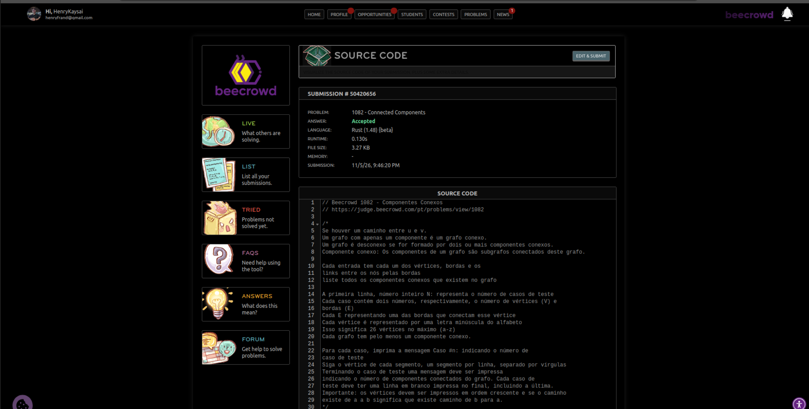

# Problema 1082: Componentes Conexos

**Problema:** [Componentes Conexos](https://judge.beecrowd.com/pt/problems/view/1082)  

---

## 📌 Descrição do Problema

O problema dá vários grafos não-direcionados, um por caso de teste Para cada grafo, devemos listar os componentes conexos, cada grupo em ordem alfabética, e no final dizer quantos grupos existem. 

---

## 💡 Abordagem

Primeiro eu absorvi o input tratando todo o conteúdo recebido como uma grande string separada por espaços em branco (`split_whitespace`). Então eu recebia primeiro o valor do número de testes, que seria a primeira palavra da string. A cada próximo `next()` que se utiliza, o iterador criado vai para a próxima linha. Como a segunda linha do input me diz quantos vértices (v) e quantas arestas (a) eu tenho, é fácil perceber que devemos iterar a vezes pelos componentes e então iterar sob as linhas seguintes pensando em conectar os elementos. 
1. **Representação do grafo:** cada letra foi convertida para um número em ASCII porque Vetores em Rust não aceitam strings. Então esses números foram adicionados em uma lista de adjacência, guardando os vizinhos dos vértices.
2. **Busca dos componentes:** percorri os vértices e quando um vértice que ainda não foi visitado é encontrado, ele inicia um novo componente. Fazendo uma BFS a partir dele em uma fala, basta marcar cada componente visitado que a busca alcança.
3. **Saída:** os componentes são ordenados com `sort()` e os números são convertidos de volta para letras. 

---

## ❌ O Que Não Funcionou

>No começo achei que um componente conexo precisava ter um ciclo, ou seja, que dava para sair de um vértice e voltar a ele seguindo as arestas em uma direção, que é a definição de componente fortemente conexo. Aqui o grafo é não-direcionado, então basta existir um caminho entre cada par de vértices: `a - b - c - d - e` em linha já é um componente conexo

>Tentei ler a linha `"3 1"` com um único `parse`, mas ela tem dois números. Também tentei fazer `parse` das letras como número. Troquei para leitura por tokens e converti as letras com `as_bytes()[0] - b'a'`

>O programa parecia travar no terminal porque `read_to_string` espera EOF. Resolvi rodando com `cargo run < input.txt`

---

## 📊 Análise de Complexidade

### Tempo

Para um caso com `V` vértices e `E` arestas:

- **Montar a lista de adjacência:** O(E).
- **BFS:** O(V + E).
- **Ordenação:** O(V log V).

Total por caso: **O(V log V + E)**. O custo é dominado pela leitura das arestas. Para os `N` casos, o tempo total é a soma dos custos de cada caso, ou seja, linear no tamanho da entrada.

### Espaço

- **Lista de adjacência:** `V` vetores com `2E` entradas no total → O(V + E).
- **`visitado`, `fila` e `componente`:** no máximo `V` elementos cada → O(V).
- **Entrada:** guardo o texto inteiro na memória, o que é proporcional ao tamanho da entrada.

Total por caso: **O(V + E)**, além da entrada.

---

## 🔍 Corretude

- A relação "existe caminho entre `u` e `v`" num grafo não-direcionado é reflexiva, simétrica e transitiva, ou seja, uma relação de equivalência. Cada vértice pertence a exatamente um componente.
- A BFS a partir de `s` visita exatamente os vértices alcançáveis a partir de `s`: ela só anda por arestas, então não visita ninguém fora do componente, e só para quando a fila esvazia, então não deixa de fora ninguém alcançável. Cada BFS encontra exatamente um componente inteiro.
- O vetor `visitado` garante que uma BFS só começa em vértices que ainda não pertencem a nenhum componente encontrado, então nenhum componente é contado duas vezes.
- O loop passa por todos os vértices de `0` a `v-1`, então nenhum componente fica de fora, inclusive vértices isolados.
- Arestas repetidas ou de um vértice para ele mesmo (`a a`) não causam problema, porque o `visitado` impede que um vértice entre duas vezes no componente.

---

## 🚀 O Que Poderia ser Melhorado

- acumular tudo numa `String` e imprimir uma vez só no final.
- resolver com Union-Find, juntando os conjuntos de `u` e `v`.
- marcar os vértices do componente e percorrer de `0` a `v-1` imprimindo os marcados já daria a ordem crescente.
- os nomes `componente` (lista de vértices) e `componentes` (contador) me confundiram durante a implementação. Nomes como `grupo` e `total` seriam mais claros. Separar a BFS numa função também deixaria o `main` mais curto.
- o código usa `unwrap()` em todo lugar. Num programa real seria melhor tratar entradas inválidas.

---

## 📸 Evidência de Submissão

