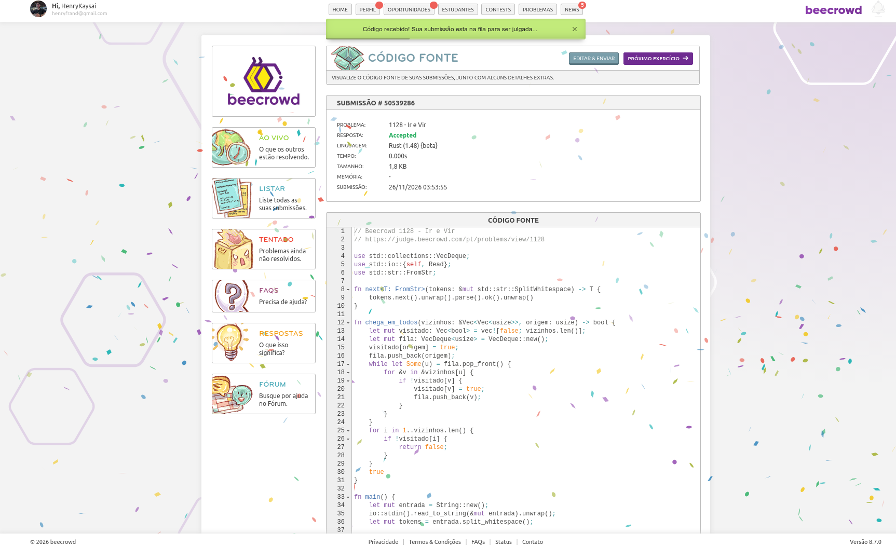

# Problema 1128: Ir e Vir

Problema: [Ir e Vir](https://judge.beecrowd.com/pt/problems/view/1128)

---

## 📌 Descrição do Problema

A cidade tem N cruzamentos e M ruas, umas de mão única e outras de mão dupla. Tem que dizer se dá pra ir de qualquer cruzamento pra qualquer outro.

---

## 💡 Abordagem

Ver se o grafo é fortemente conexo

- uma BFS a partir do 1 no grafo normal (ida), pra ver se o 1 chega em todo mundo
- uma BFS a partir do 1 no grafo com as ruas invertidas (volta), pra ver se todo mundo chega no 1

Se as duas passam, qualquer cruzamento chega em qualquer outro passando pelo 1. Rua de mão dupla (P = 2) entra nos dois sentidos

A leitura usa a função next, igual aos outros

---

## ❌ O Que Não Funcionou

A primeira ideia foi rodar uma BFS de cada vértice e ver se todos chegam em todos, muito lento, então troquei pelas duas BFS

---

## 📊 Análise de Complexidade

### Tempo

Montar os dois grafos é O(M) e cada BFS é O(N + M)

Total: O(N + M) por caso

### Espaço

Os dois grafos e o vetor de visitados: O(N + M)

---

## 🔍 Corretude

Se o 1 chega em todos e todos chegam no 1, então de qualquer u dá pra ir até o 1 e do 1 até qualquer v logo, o grafo é fortemente conexo

Se alguma BFS não chega num vértice x, ou o 1 não chega em x ou x não chega no 1. Aí o grafo não é fortemente conexo

---

## 🚀 O Que Poderia ser Melhorado

Usar Kosaraju ou Tarjan, que também dizem quantas componentes fortemente conexas existem

O grafo volta é montado mesmo quando a primeira BFS já falhou

---

## 📸 Evidência de Submissão

