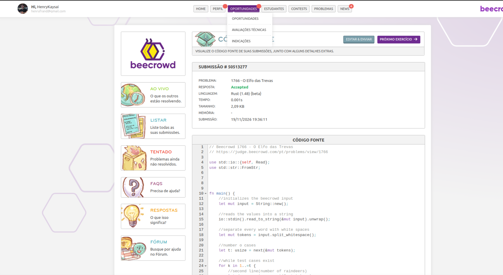

# Problema 1766: O Elfo das Trevas

**Problema:** [O Elfo das Trevas](https://judge.beecrowd.com/pt/problems/view/1766)  

---

## 📌 Descrição do Problema

Em cada caso temos uma lista de renas, cada uma com nome, peso, idade e altura, e um número que diz quantas delas vão puxar o trenó. Precisamos escolher as renas que puxam, seguindo uma ordem definida pelo exercício, peso, idade, altura e depois nome. A saída de cada cenário é a lista das renas escolhidas, numerada de 1 até K, na ordem que classificamos.

---

## 💡 Abordagem

Percebi que o problema é, no fundo, uma **ordenação com vários critérios de desempate**.

1. **Leitura:** Li a entrada inteira de uma vez e separei por espaços em branco (`split_whitespace`), consumindo um token por vez. Uma função genérica `next<T: FromStr>` faz o `parse` para o tipo que eu precisar (`usize`, `i32`, `f64` ou `String`), o que evita repetir `.unwrap().parse().unwrap()` pelo código.
2. **Modelagem:** Cada rena vira uma `struct`. A função `stash_deers` lê os quatro campos e devolve a struct pronta.
3. **Ordenação:** Usei `sort_by` com um comparador encadeado por `then_with`: peso decrescente (`b.weight.cmp(&a.weight)`), depois idade crescente, altura crescente e nome crescente. O `then_with` só avalia o critério seguinte quando o anterior empata.
4. **Saída:** Imprimo `CENARIO {k}` e, para as K primeiras renas do vetor já ordenado (`take(K)`), imprimo `posição - nome`, com a posição vindo do `enumerate`.

---

## ❌ O Que Não Funcionou

Os erros foram todos de compilação ou de lógica (essa parte foi gerada por IA conforme eu ia pedindo pra ela me explicar meus erros (ela não teve influência na lógica e nem no código que usei, somente para auxílio nas correções e explicações)):

**Na função de ordenação**

- **Assinatura inválida.** Escrevi `fn ordering_deers(&vec: Vec<LasRenasLocas>)`, com o `&` no lugar errado. O que vem antes do `:` é o nome, e o `&` vai no tipo. Como o `sort_by` altera o vetor, a referência precisa ser mutável: `vec: &mut Vec<LasRenasLocas>`.
- **Parêntese faltando.** O `);` do final fechava só o último `then_with`, e o `sort_by(` ficava aberto. Faltava um `)` a mais antes do `;`.
- **Comparar `f64` com `cmp`.** A altura é decimal, e `f64` não implementa `Ord` (por causa do `NaN`), então `a.height.cmp(&b.height)` não compila. Troquei por `partial_cmp`, mas ele devolve `Option<Ordering>` e o `then_with` espera `Ordering` (erro E0308). Faltava o `.unwrap()`, que é seguro aqui porque a entrada nunca tem `NaN`.

**Na chamada da função**

- **Função nunca chamada.** Ela existia, mas o `main` não a usava, e eu só imprimia o vetor com `{:#?}` para depurar.
- **Faltou o `&mut` na chamada.** Passei `ordering_deers(deer_vec)`, que entrega o vetor inteiro, e a função pedia uma referência mutável. O certo é `ordering_deers(&mut deer_vec)`, o mesmo padrão que já usava em `next(&mut tokens)`.
- **Ordenação dentro do loop de leitura.** Coloquei a chamada dentro do `for` que lê as renas, então o vetor era reordenado a cada rena lida. Funcionava, mas era desperdício: a ordenação deve rodar uma vez, depois de ler todas.

**Na saída**

- **Número do cenário errado.** Imprimi `t` (total de casos) em vez do caso atual, então todos os cenários sairiam com o mesmo número. Troquei `for _ in 0..t` por `for k in 1..=t`, que começa em 1 e dá o contador.
- **Formato do cabeçalho.** O texto `CENARIO {k}` tem chaves literais, que no `println!` precisam ser escapadas dobrando-as (`"CENARIO {{{}}}"`). Também tinha deixado um `\n` extra, que gerava uma linha em branco que o enunciado não pede.
- **`for _ in 0..deer_vec`.** O intervalo `0..x` precisa de um número, e `deer_vec` é um `Vec`. Para percorrer os itens, é preciso iterar sobre o próprio vetor com `.iter()`.
- **`deer_vec.name`.** O `name` pertence a cada rena, não ao vetor. Precisava usar a variável do loop, que representa a rena atual.
- **Contador manual dentro do loop.** Declarei `let mut iterator = 1` dentro do `for`, então ele voltava a 1 a cada volta. O `enumerate()` já entrega o contador (começando em 0, por isso `i + 1`).
- **Imprimia todas as renas.** Eu ainda não usava o `pulling_deers` para limitar a saída. A solução foi encadear `iter()`, `take(pulling_deers)` e `enumerate()`.

**Pontos de atenção que confirmei**

- **Direção da ordenação.** O peso é o único critério decrescente, e os outros são crescentes. Para inverter só o peso, troquei a ordem dos operandos (`b.weight.cmp(&a.weight)`) em vez de ordenar tudo e inverter depois.

---

## 📊 Análise de Complexidade

### Tempo

Cada rena tem 4 campos, então ler tudo custa O(N)
- `sort_by` custa O(N log N), e cada comparação é O(1) para peso, idade e altura. A comparação de nomes custa O(L), com L sendo o tamanho do nome, mas só ocorre em empates completos nos três critérios anteriores, e L é pequeno.
- imprimir as K primeiras custa O(K)

**O(N log N)**, dominado pela ordenação

### Espaço

- O vetor de renas guarda `N` structs → O(N).
- A entrada inteira fica em memória como uma `String`, proporcional ao tamanho da entrada

**O(N)**

---

## 🔍 Corretude

- O comparador define uma ordem: ele compara peso, depois idade, depois altura e depois nome, e só passa para o critério seguinte quando o atual empata
- O desempate final pelo nome torna a ordem determinística, porque duas renas diferentes nunca têm o mesmo nome. Assim, o resultado não depende da estabilidade do algoritmo de ordenação nem da ordem de entrada.
- Depois de ordenado, as K primeiras posições são exatamente as K renas de maior prioridade, e `take(K)` com `enumerate` imprime já numeradas.
- O contador `k` do cenário começa em 1 e vai até `t`, e a leitura por tokens consome exatamente `N` renas por cenário, então os cenários não se misturam.

---

## 🚀 O Que Poderia ser Melhorado

- como só interessam as K primeiras, daria para usar `select_nth_unstable_by` (ou um heap de tamanho K) e ordenar apenas esse pedaço, o que fica em O(N + K log K) em vez de O(N log N). Para os tamanhos do problema, a diferença é desprezível.
- acumular tudo numa `String` e imprimir uma vez só, em vez de vários `println!`.
- o nome `LasRenasLocas`, mas `Rena` seria mais claro.
- o código usa `unwrap()` em todo lugar, inclusive no `partial_cmp`. Num programa real, uma entrada inválida (por exemplo, altura `NaN`) causaria panic.

---

## 📸 Evidência de Submissão

