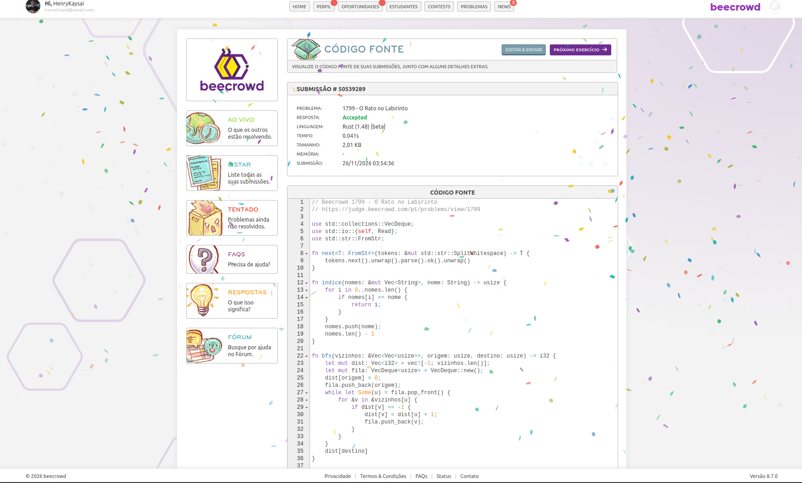

# Problema 1799: O Rato no Labirinto

**Problema:** [O Rato no Labirinto](https://judge.beecrowd.com/pt/problems/view/1799)  

---

## 📌 Descrição do Problema

> *(Descreva brevemente o problema com suas próprias palavras — não copie o enunciado.)*

---

## 💡 Abordagem

> *(Explique a ideia central da sua solução. O que você percebeu sobre o problema? Qual estratégia usou? Por que ela funciona?)*

---

## ❌ O Que Não Funcionou

> *(Documente tentativas anteriores que falharam ou abordagens que você considerou mas descartou. Qual foi o erro? TLE? WA? Lógica errada?)*

---

## 📊 Análise de Complexidade

### Tempo

> *(Justifique usando notação assintótica. Identifique os loops, recursões ou operações dominantes.)*

### Espaço

> *(Justifique usando notação assintótica. Considere estruturas de dados usadas, recursão, etc.)*

## 🔍 Corretude

> *(Argumente brevemente por que sua solução é correta. Pode ser informal, mas deve ter lógica.)*

---

## 🚀 O Que Poderia ser Melhorado

> *(Reflita: existe solução mais eficiente? O código poderia ser mais legível? Há casos extremos mal tratados?)*

---

## 📸 Evidência de Submissão

> *(Adicione o print do Beecrowd mostrando "Accepted" abaixo)*

