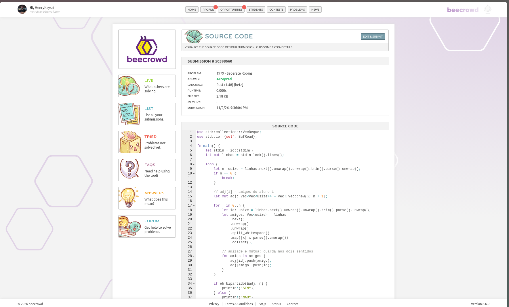

# Problema 1979: Salas Separadas

**Problema:** [Salas Separadas](https://judge.beecrowd.com/pt/problems/view/1979)  

---

## 📌 Descrição do Problema

> O problema imagina duas salas e amigos fazendo uma prova. A solução deve encontrar incompatibilidades entre os alunos que tem amizades e que não podem ficar na mesma sala realizando o teste. Neste caso, existe uma entrada que se dá pela primeira linha indicando o número de alunos da lista. A próxima linha vai ser o ID de um aluno e a próxima os seus amigos que devem ficar em salas separadas e assim subsequentemente.

---

## 💡 Abordagem

> Minha solução se baseia em BFS, basicamente eu tenho que declarar cada aluno como um vértice e cada amizade como uma aresta. Separar os alunos equivale a colorir os vértices com duas "cores" diferentes/verificar se é bipartido.

1. Ler a entrada e montar a lista de adjacência
2. Usar um vetor `cor`, em que `-1` significa que o aluno ainda não tem sala, `0` é a sala A e `1` a sala B
3. Itero sob todos os alunos. Se um ainda não tem sala, atribui-se uma sala para ele e começo uma BFS a partir dele. Faço isso para todos os alunos porque o grafo pode ter partes sem ligação
4. Na BFS, cada amigo sem sala vai para a sala oposta à do aluno atual e entra na fila
5. Se um amigo ja tem sala igual a do aluno atual, há dois amigos na mesma sala, então a saída é `NAO`
6. Se a busca termina sem conflito, a resposta é `SIM`

**Por que funciona:** ao colocar o aluno inicial numa sala, a sala de cada amigo dele fica obrigada a ser a oposta. Não há escolha a fazer dentro de cada grupo conectado. Se aparecer um conflito, ele vem de uma regra e prova que não existe distribuição possível. Isso ocorre quando há um ciclo de tamanho ímpar, como o triângulo formado pelos alunos 1, 2 e 4 no terceiro exemplo.

---

## ❌ O Que Não Funcionou

- **Leitura da entrada:** no começo li apenas o `N` e a linha seguinte como se fosse a lista de amigos. Mas essa linha era o **ID** do aluno, e só a próxima era a lista. Como o ID também é um número válido, o `parse` não deu erro e o vetor de amigos saiu errado. Corrigi lendo duas linhas por aluno (ID e depois os amigos), dentro de um laço de `N`, e um laço externo para os vários casos de teste até o `N = 0`.
- **Interpretação do problema:** inicialmente pensei que os alunos de uma mesma sala não deveriam "se conectar" no grafo de forma geral. O correto é que **não pode haver aresta entre dois alunos da mesma sala**, enquanto as arestas entre salas diferentes são permitidas.
- **Arestas repetidas:** a lista de adjacência ficou com vizinhos duplicados (por exemplo `[2, 3, 2, 3]`), porque a entrada declara cada amizade nas duas linhas e eu guardo nos dois sentidos. Considerei remover duplicatas ou guardar só um sentido, mas mantive, porque o enunciado não garante que a amizade apareça nas duas linhas, e a duplicação não afeta o resultado.

---

## 📊 Análise de Complexidade

### Tempo

Seja `V` o número de alunos `N` e `E` o número de arestas guardadas na lista de adjacência.

Por caso de teste:
- **Leitura e montagem do grafo:** cada amigo lido faz dois `push`, então custa `O(V + E)`.
- **Coloração:** o laço externo visita cada aluno uma vez (`O(V)`). Cada aluno entra na fila no máximo uma vez, porque só entra quando está sem cor e recebe uma cor ao entrar. Ao sair da fila, percorre sua lista de vizinhos, e a soma dessas listas é `O(E)`.

O total é **O(V + E)** por caso. Como `V ≤ 100`, `E` é no máximo da ordem de `V²`.

### Espaço

A lista de adjacência ocupa `O(V + E)`. O vetor `cor` ocupa `O(V)` e a fila guarda no máximo `V` alunos, `O(V)`. O total é **O(V + E)**.

## 🔍 Corretude

Em cada grupo de alunos conectados por amizades, a sala do primeiro aluno é uma escolha arbitrária e todas as outras são forçacas: o amigo de quem está na sala A só pode ficar na B, o amigo deste só pode ficar na A e assim por diante.

- Se aparece uma aresta ligando dois alunos com a mesma sala, essa aresta fecha um ciclo e não existe distribuição possível em duas salas, então `NAO` está correto.
- Se a busca termina sem conflito, toda aresta liga salas diferentes, e a distribuição encontrada serve de prova de que `SIM` é a resposta.

Cada grupo desconectado é tratado de forma independente pelo laço externo, então partes separadas do grafo não ficam de fora.

---

## 🚀 O Que Poderia ser Melhorado

- **Eficiência:** `O(V + E)` já é o ótimo para esse problema, já que é preciso ler todas as arestas.
- **Legibilidade:** a leitura de linhas repete `linhas.next().unwrap().unwrap()`, e poderia ser uma função auxiliar. Também daria para trocar o `-1/0/1` do vetor `cor` por um `Option<bool>` ou um `enum`, para o código dizer mais claramente o que cada valor significa.
- **Robustez na entrada:** o código usa `unwrap()` e assume que o `0` final sempre existe. Se a entrada acabasse sem o `0`, o programa daria `panic`. Uma versão mais defensiva trataria o `None` e encerraria o laço.
- **Duplicatas na lista de adjacência:** poderiam ser removidas, mas não mudam o resultado.
- **Alternativa:** uma DFS também resolveria, mas iterativa ou recursiva ela seria mais trabalhosa em Rust do que a BFS com fila.

---

## 📸 Evidência de Submissão

> *(Adicione o print do Beecrowd mostrando "Accepted" abaixo)*

